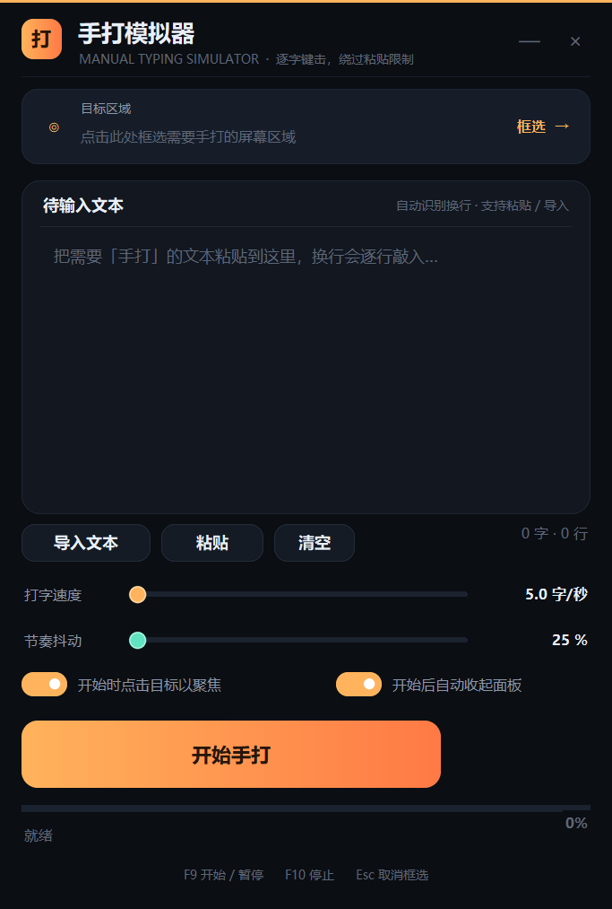

# 手打模拟器 · Hand Typing Simulator

> 有些网页 / 平台 / 软件禁止粘贴，就是不让复制。  
> 那就让电脑替你「手打」——框选输入框，逐字键击，绕过一切粘贴检测。



## 下载

- **Windows 单文件版**：[`ShouDa.exe`](../../releases/latest)（Release 附件，免安装单文件版）（免安装，双击即用）
- 源码：直接克隆本仓库，或下载 [shouda.py](shouda.py)

## 这是什么

手打模拟器是一个 Windows 桌面浮窗工具。它不使用剪贴板，而是通过 Win32 `SendInput` 以 **Unicode 键盘事件** 逐字敲入文本，对目标程序来说，这和真人敲键盘完全一样。

因此：

- 对禁用粘贴（`Ctrl+V` 无效、右键粘贴被拦截、`paste` 事件被监听）的输入框依然有效
- 中文、emoji、符号均可直接输入，不依赖输入法
- 自动识别换行，`\n` 会被敲成回车键，`\t` 会被敲成 Tab

## 功能

| 功能 | 说明 |
| --- | --- |
| 屏幕框选 | 全屏遮罩上拖拽框选目标输入区域，自动记录坐标 |
| 文本导入 | 直接粘贴、或从 `.txt` / `.md` 等文件导入待输入文本 |
| 逐字键击 | 逐字符 Unicode 注入，可模拟人工节奏 |
| 打字速度 | 1.0 ~ 20.0 字/秒无级调节 |
| 节奏抖动 | 0 ~ 80%，随机化每个字的间隔，更像真人 |
| 自动聚焦 | 开始前自动点击目标区域，让输入框获得焦点 |
| 自动收起 | 开始手打后浮窗自动收起成迷你进度条，不挡视线 |
| 暂停 / 继续 / 停止 | 全局热键随时控制 |
| 进度反馈 | 实时进度、百分比、剩余时间、完成提示 |

## 使用步骤

1. 双击 `启动手打模拟器.bat`（或直接运行 `手打模拟器.exe`）
2. 点击「框选」，在屏幕上拖出一个矩形，覆盖你要填字的目标输入框（Esc 取消）
3. 把要输入的文本粘贴进文本框，或点「导入文本」选择文件
4. 按需调整「打字速度」和「节奏抖动」
5. 点「开始手打」（或按 `F9`）
   - 3 秒倒计时后自动点击目标区域并开始逐字输入
   - 默认会自动收起面板，只留一条进度条
6. 需要中断时按 `F9` 暂停、`F10` 停止

### 快捷键

| 按键 | 作用 |
| --- | --- |
| `F9` | 开始 / 暂停 / 继续 |
| `F10` | 停止 |
| `Esc` | 取消框选 |

## 从源码运行

需要 Python 3.8+ 与 Pillow：

```bash
pip install -r requirements.txt
python shouda.py
```

## 打包为单文件 exe

```bash
pip install pyinstaller
python -m PyInstaller --onefile --noconsole --name ShouDa --icon shouda_icon.ico shouda.py
```

## 实现原理

- **键盘注入**：`user32.SendInput` + `KEYEVENTF_UNICODE`，一次按下 / 抬起注入一个 UTF-16 码元，完全不经过剪贴板与输入法
- **鼠标聚焦**：`SetCursorPos` + `mouse_event` 左键点击目标区域，让窗口获得焦点后再开始输入
- **全局热键**：独立线程 `RegisterHotKey` + `GetMessageW` 消息循环，实现 F9 / F10
- **界面**：Tkinter 无边框浮窗，配合 Pillow 4x 超采样绘制圆角卡片、渐变按钮、自绘滑杆 / 开关 / 进度条；按系统 DPI 等比缩放
- **高 DPI**：进程级 DPI 感知，保证 Tk 坐标、`SetCursorPos` 坐标、截图坐标三者一致

## 已知限制

- 无法向「以管理员权限运行」的程序注入按键（Windows UIPI 限制）。如目标程序是管理员权限，请也以管理员身份启动本工具
- 目标窗口必须能被正常激活；部分全屏独占游戏或带反注入保护的软件可能拦截键击
- 框选坐标基于当前屏幕布局，请勿在开始手打前移动 / 缩放目标窗口

## 免责声明

本工具仅用于提升自己在合法场景下的输入效率，例如在禁止粘贴的在线表单中填写自己有权提交的内容。请勿用于绕过任何平台的安全机制、批量发布垃圾信息或其他违反服务条款的行为。使用造成的后果由使用者自行承担。

## License

[MIT](LICENSE)
